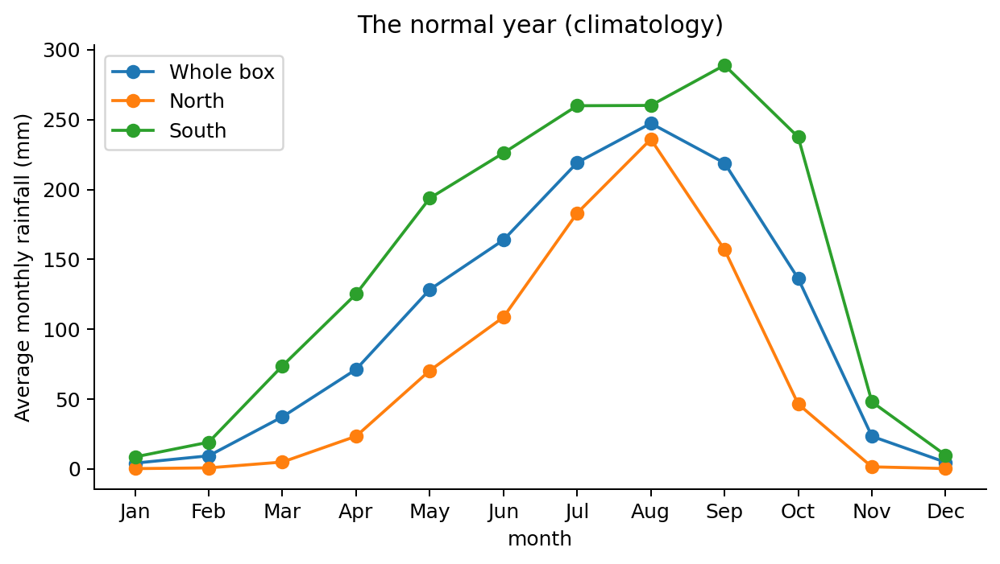
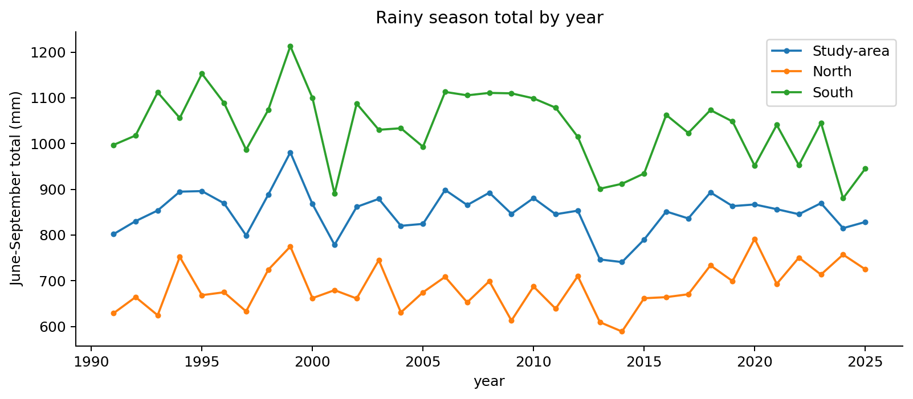
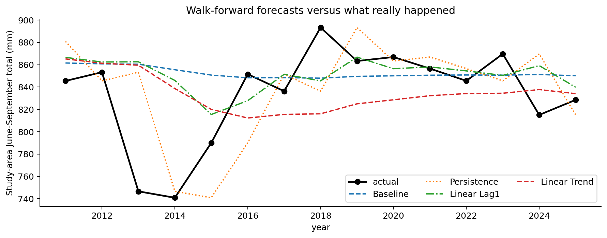
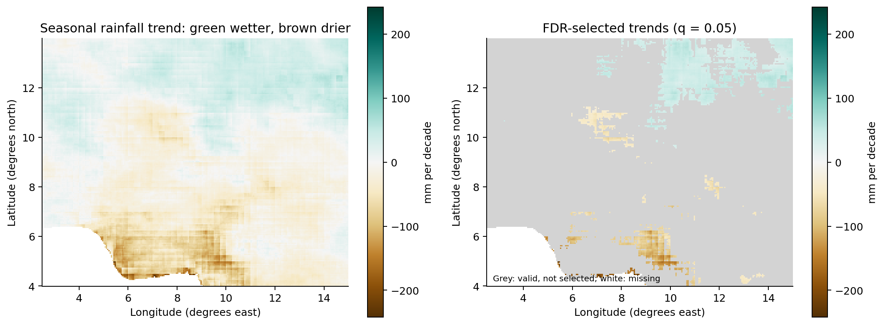

# Seasonal rainfall patterns and forecasting around Nigeria

An exploratory analysis of CHIRPS monthly rainfall in a rectangular study area around Nigeria. The local dataset covers **1991–2025**. The project describes June–September rainfall patterns and trends, then tests four simple methods for predicting seasonal totals from earlier observations.

**Validated run:** the notebook and exported results use January 1991–December 2025. All code cells completed successfully, including calendar, coverage and historical forecast checks.

## Research question

> How has June–September rainfall varied across the study area, where are trends apparent, and how accurately can simple methods predict seasonal totals using earlier years?

The main task is understanding historical rainfall. Forecasting is a secondary experiment, rather than an operational weather forecast.

## Data and geographic scope

| Item | Description |
|---|---|
| Product | CHIRPS version 2.0 monthly rainfall |
| Resolution | 0.05 degrees, approximately 5 km |
| Bounds | Latitude 4–14°N; longitude 2.5–15°E |
| Local data period | January 1991–December 2025: 420 months |
| Season | June, July, August and September |
| Variable | `precip`, monthly accumulation labelled `mm/month` |
| Seasonal units | Millimetres summed over the four months |
| Data file | `data/chirps_nigeria.nc` |

**The study area includes neighbouring countries.** No Nigeria boundary mask is applied, so spatial averages describe the study box, not Nigeria-only national rainfall. North and south refer to portions of this box divided at 9°N.

CHIRPS blends satellite information and rain-gauge observations. See the [CHIRPS project page](https://www.chc.ucsb.edu/data/chirps). Data were downloaded from the [original UCSB monthly netCDF source](https://data.chc.ucsb.edu/products/CHIRPS-2.0/global_monthly/netcdf/), using partial reads of compressed blocks intersecting the study area. The notebook uses this same UCSB source when the local dataset is absent.

**Spatial averaging:** regional means use weights proportional to `cos(latitude)`, accounting for the latitude-dependent areas of cells on this regular grid. Permanently missing cells are excluded and weights are renormalized over available cells.

**Season choice:** June–September provides a fixed window for comparing the northern main rainy season across years. The monthly climatology helps assess this choice. Southern rainfall extends outside this window, so the seasonal comparisons do not represent each region's full rainy season.

The large `.nc` file is excluded from Git. The completed source, bounds and checksum are in `results/data_manifest.json`.

## Workflow

1. Download and inspect monthly rainfall.
2. Check units, calendar, impossible values and missing coverage.
3. Calculate monthly climatology and anomalies.
4. Sum June–September rainfall for each year and grid cell.
5. Estimate trends in mm per decade and examine statistical evidence.
6. Predict historical seasons using earlier years only.
7. Save figures, predictions, metrics and environment information.

The workflow requires a complete, unique monthly calendar and all four months for each seasonal total. It rejects unexpected units, invalid coordinates, infinite values and intermittent missing coverage. Permanently missing cells remain masked.

**Dask demonstration:** the notebook checks numerical agreement between chunked and in-memory trend calculations. Local timings include different loading and scheduling costs; they are not a controlled benchmark or evidence that the full workflow scales efficiently.

**Coverage verification:** run `python verify_spatial_weights.py` after obtaining the data. It checks regular grid spacing, constant coverage, normalized weights, exclusion of missing cells, and agreement with spherical cell-area weighted monthly means within 0.001 mm. Results are in `results/spatial_weighting_checks.json`. The verified box has 46,874 valid cells out of 50,000, no intermittently missing cells, and 93.7% available area. The largest difference in monthly means is below 0.0005 mm. This is study-box coverage, not Nigeria-only coverage.

## How forecasting works

The exported table contains **15 comparisons, from 2011 through 2025**:

| Year predicted | Earlier observations available |
|---|---|
| 2011 | Through 2010 |
| 2012 | Through 2011 |
| … | … |
| 2025 | Through 2024 |

| Method | Prediction rule |
|---|---|
| Historical-mean baseline | Average earlier seasonal totals |
| Persistence | Repeat the previous year's total |
| Lag regression | Learn the relationship between successive years |
| Trend regression | Fit rainfall against year and extend the line |

The year being predicted must never enter its own model fitting. Full-period climatology is descriptive and must not reveal future observations through forecast features.

**Training data:** the historical-mean baseline uses every available earlier season, starting in 1991. Both regressions use a shared lag-feature table whose target years start in 1992; 1991 supplies the first previous-year value.

This is retrospective forecasting: the historical years already happened, but each prediction uses only earlier information. There is no separate 2025 evaluation script and no issued 2026 forecast.

## Results and visualizations

### Normal rainfall patterns

The completed 1991–2025 summary gives a mean June–September total of **849.6 mm**, with northern and southern averages of **684.8 mm** and **1035.3 mm**. Monthly climatology peaks in August for the whole box and north, and September for the south.



*Average rainfall by calendar month. The regional curves describe portions of the rectangular study area.*



*Each point represents one year's June–September total averaged over the available cells in that region. Year-to-year variation is distinct from a long-term trend.*

### Historical forecast evaluation

The current CSV exports report:

| Method | MAE (mm) | RMSE (mm) | Skill against baseline |
|---|---:|---:|---:|
| Historical mean | 32.793 | 48.286 | 0.000 |
| Persistence | 32.368 | 42.651 | 0.220 |
| Lag regression | 30.812 | 45.740 | 0.103 |
| Trend regression | 38.769 | 49.703 | -0.060 |

Persistence has the lowest RMSE; lag regression has the lowest MAE. Positive skill means lower mean squared error than the baseline. Here, persistence's score represents about 22.0% lower mean squared error for this baseline and period, not guaranteed future accuracy.



*Predicted seasonal rainfall compared with actual observations. Each prediction must use earlier years only.*

The 2025 comparison is included in the same forecast table. The trend method was closest in that particular year, while persistence performed best by RMSE across the whole period. One good year does not establish reliable forecasting skill.

### Seasonal rainfall trends

The mean slope is **−7.4 mm per decade**, with 43.0% of valid cells showing positive slopes and 57.0% negative slopes. Benjamini–Hochberg false discovery rate selection at q = 0.05 selects 11.6% of valid cells. Temporal autocorrelation is not explicitly modelled, and spatial dependence remains a limitation. The area-average slope is descriptive and has no separate significance test here.



*Left: estimated change in mm per decade. Right: cells selected after correction for multiple testing.*

**Autocorrelation check:** the notebook removes each fitted linear trend and checks correlation between consecutive annual residuals. It exports grid-cell correlation quantiles and regional lag-one correlations and Durbin–Watson statistics. These are descriptive diagnostics, not corrected trend tests. Low lag-one correlation cannot establish independence at every lag. FDR handles multiple testing, not serial correlation; the trend maps remain exploratory. The separate HAC sensitivity analysis below investigates dependence-aware uncertainty without replacing the OLS map. See the [regression diagnostics guide](https://www.statsmodels.org/dev/diagnostic.html).

The completed residual check gives lag-one correlations of **0.313** for the study box, **0.035** for the north and **0.170** for the south. Across grid cells, the median is **-0.002**, with the 5th–95th percentiles spanning **-0.259 to 0.270**. These values do not constitute a formal independence test or a correction to the trend p-values.

**No climate-change attribution:** these trends describe the observed rainfall record. This analysis does not establish whether human-caused climate change, natural variability or other drivers caused them.

### Temporal-dependence sensitivity

The final notebook cell runs `verify_analysis.py`, which independently reconstructs all 15 historical predictions and checks the exported metrics. It also compares OLS inference with Newey–West/HAC uncertainty estimates for complete, equally spaced annual series. Slopes remain unchanged.

HAC uses Bartlett weights, lag windows of 1, 3 and 5 years, covariance correction `n/(n−2)`, and an approximate `t(n−2)` reference. These windows are sensitivity choices fixed before comparison; 3 years also matches the default bandwidth formula for this record length. BH selection at q = 0.05 is applied separately to each method. The implementation is checked against statsmodels at 12 representative cells per lag window. See the [HAC method documentation](https://www.statsmodels.org/stable/generated/statsmodels.stats.sandwich_covariance.cov_hac.html).

| Inference method | Fraction of valid cells selected by BH |
|---|---:|
| OLS | 11.6% |
| HAC, lag 1 | 15.7% |
| HAC, lag 3 | 20.6% |
| HAC, lag 5 | 23.4% |

HAC can increase or decrease estimated uncertainty. The differences show sensitivity to the inference method and lag window; they do not identify a definitive percentage of cells with changing rainfall. Thirty-five years is a small sample for approximate inference, and spatial dependence remains a limitation. The existing map and main summary retain **OLS-based** selection; separate sensitivity tables report comparisons and regional approximate confidence intervals. The regional intervals are not adjusted for multiple regional comparisons. No method is chosen simply because it selects more cells.

## Run the project

The tested environments use **Python 3.13.9 on Windows**: the existing Anaconda environment and a fresh isolated `.venv` created from its Python interpreter. Exact core package versions are recorded in `requirements.txt` and `results/environment.json`. The runner explicitly launches its notebook kernel with the same Python interpreter used to start the script.

If these files are already open in VS Code, reload changes from disk before saving to avoid overwriting the completed run with an older editor copy.

**Fresh-environment verification passed (12 October 2026).** Dependencies installed successfully into `.venv` with system packages disabled, `pip check` reported no broken requirements, and `run_analysis.py` completed the notebook and integrated verification checks using `.venv\Scripts\python.exe`. Outputs were saved successfully. This test reused the existing local CHIRPS dataset; downloading the dataset again was not tested.

For a fresh environment, open a terminal in this folder and install the recorded core versions:

```powershell
python -m venv .venv
.venv\Scripts\Activate.ps1
python -m pip install -r requirements.txt
```

On macOS or Linux, activate with `source .venv/bin/activate`.

Open `nigeria_rainfall_analysis.ipynb`, click **Select Kernel**, select the environment containing the dependencies and run cells from the top. Alternatively, execute and save notebook outputs, then verify spatial weighting:

```powershell
python run_analysis.py
python verify_spatial_weights.py
```

For the existing Anaconda installation when `python` is not on PATH:

```powershell
& "$env:USERPROFILE\anaconda3\python.exe" -m pip install -r requirements.txt
& "$env:USERPROFILE\anaconda3\python.exe" run_analysis.py
```

You can also run `jupyter lab`. The standalone downloader currently requests 1991–2025. The notebook validates and reuses the local file when it is present.

## Verification scripts

The notebook's final cell runs both verification scripts automatically:

- `verify_analysis.py` independently reconstructs historical predictions, checks MAE/RMSE/skill, and runs the OLS-versus-HAC trend sensitivity comparison. It uses statsmodels to cross-check the vectorized calculations.
- `verify_spatial_weights.py` checks grid spacing, missing-cell coverage, normalized area weights and agreement with spherical cell-area averages.

These scripts are part of the analysis and should stay in the repository. `requirements.txt` is the single installation file, pinned to the core versions used in the successful runs. `results/environment.json` records those versions as analysis metadata; it is not another installation file. These core pins do not lock every indirect dependency or guarantee compatibility on other systems.

## Files and outputs

```text
climate-rainfall-nigeria/
  nigeria_rainfall_analysis.ipynb   analysis and explanations
  download_chirps.py               direct UCSB subset downloader
  run_analysis.py                  execute and save notebook outputs
  verify_analysis.py                forecast audit and HAC sensitivity
  verify_spatial_weights.py         verify coverage and spatial weights
  requirements.txt                pinned core Python dependencies
  README.md                       project guide
  .gitignore                      exclude data and local clutter
  data/                           downloaded rainfall, excluded from Git
  figures/                        exported plots
  results/                        metrics and reproducibility records
```

| Output | Contents |
|---|---|
| `results/forecast_predictions.csv` | Actual and predicted rainfall for 2011–2025 |
| `results/analysis_verification.json` | Independent forecast checks and inference comparison metadata |
| `results/trend_inference_sensitivity.csv` | OLS versus HAC cell-selection sensitivity |
| `results/regional_trend_sensitivity.csv` | Regional slopes and approximate OLS/HAC intervals |
| `results/spatial_weighting_checks.json` | Coverage and independent spherical-area weighting checks |
| `results/metrics.csv` | MAE, RMSE and skill for four methods |
| `results/trend_autocorrelation.json` | Cell-level residual correlation quantiles and regional diagnostics |
| `results/analysis_summary.json` | Summary of the completed analysis and forecast evaluation |
| `results/data_manifest.json` | Dataset source, bounds, period, size and checksum |
| `results/environment.json` | Recorded Python, platform and package versions |
| `figures/` | Maps, climatology, anomalies, seasonal series and forecast charts |

## Terms in plain language

| Term | Meaning |
|---|---|
| Grid cell | One small geographic square with a rainfall estimate |
| netCDF | Numerical data stored with dates, coordinates and metadata |
| Xarray | Python tools for labelled arrays such as time × latitude × longitude |
| Climatology | Average rainfall for each calendar month over a chosen period |
| Anomaly | Observed rainfall minus its calendar-month average |
| Seasonal total | Rainfall summed over the selected months |
| Area weighting | Account for different grid-cell areas when averaging |
| Trend | A fitted line's slope, expressed here in mm per decade |
| p-value | Under a no-trend model, the probability of a result at least as extreme as the observed test statistic |
| FDR | False discovery rate: an approach to multiple testing with assumptions about dependence |
| Dask | Chunked, lazy computation for larger datasets |
| Lag | A previous value used as a predictor |
| Walk-forward evaluation | Predict a year using earlier observations, then advance one year |
| MAE | Average absolute prediction error; lower is better |
| RMSE | Error measure giving greater weight to large mistakes; lower is better |
| Skill | `1 − MSE_model / MSE_baseline`; positive values beat the baseline |

## Limitations

- The rectangle includes neighbouring countries; Nigeria-only conclusions require a boundary mask.
- June–September fits the northern main season better than the longer southern season.
- CHIRPS is an estimate, with uncertainty influenced by rain-gauge coverage.
- Thirty-five years is a limited climate record. Residual autocorrelation is investigated descriptively, but the main map uses OLS p-values; separate HAC sensitivity tables address dependence under additional assumptions.
- Spatial testing needs attention to multiple comparisons and dependence. Raw and FDR-selected significance are different.
- Fifteen forecast comparisons are a small sample. The models omit ocean temperatures and other climate drivers.
- Observed trends do not establish climate-change causation or attribution.
- Seasonal totals do not establish daily flood risk, rainfall intensity or exact rainy-season onset and ending.

## Why not 2026?

As checked on 11 October 2026, the live UCSB monthly file ended in August 2026. September was missing, so a complete June–September comparison was not yet possible. No 2026 observations are included in this project. For this seasonal target, September is required; December is not.

## Learning resource

Watch [Xarray for Scalable Scientific Data Analysis — SciPy 2020](https://www.youtube.com/watch?v=mecN-Ph_-78), by Hamman, Abernathey, Cherian and Hoyer. It introduces the data-handling tools behind the project and assumes some Python/NumPy/pandas knowledge. It is not a walkthrough of this exact project or all its statistics. Use the [official Xarray tutorials](https://tutorial.xarray.dev/) alongside it.

## Credits

- **Data:** Funk, C. et al. (2015). *The climate hazards infrared precipitation with stations, a new environmental record for monitoring extremes.* Scientific Data 2, 150066. CHIRPS is produced by the UC Santa Barbara Climate Hazards Center.
- **Author:** Samuel Adegboyega. [GitHub](https://github.com/Hydrosamueldc) · [LinkedIn](https://www.linkedin.com/in/adegboyega-samuel-1a302b203).

## Publishing on GitHub

Include the Python scripts, notebook, README, requirements, `.gitignore`, exported figures and result files. The rainfall NetCDF file, caches, local environments, logs and `.env` files are excluded by `.gitignore`.

The execution script saves notebook state even if execution fails, to retain the traceback. A saved notebook alone does not indicate success: check the terminal exit status and the completion message, and inspect any cell errors.
